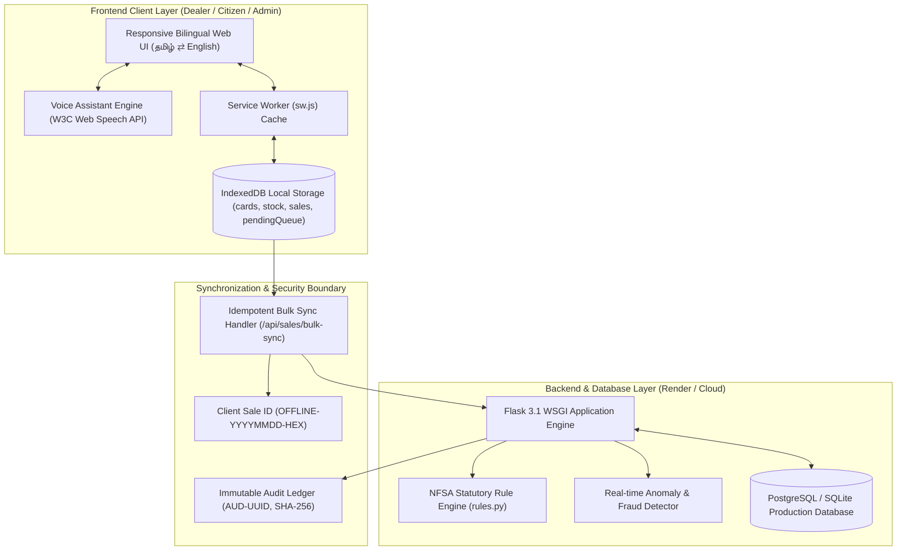

# RationSmart: Next-Gen Public Distribution System (PDS) Portal
## Comprehensive Project Overview, Architecture Workflow & Viva Defense Guide

---

## 1. Project Identity & Elevator Pitch (30-Second Summary)

> **"RationSmart is an Offline-First, Device-Agnostic, and Fully Bilingual (தமிழ் & English) Smart Public Distribution System (PDS) portal designed to eliminate grain diversion, fraudulent ghost billing, and network-related downtime in Fair Price Shops."**

It combines **Progressive Web App (PWA) client-side database caching (IndexedDB)**, **idempotent background synchronization**, an automated **NFSA statutory quota engine**, a **100% pure Tamil voice-assisted screen reader** for illiterate rural beneficiaries, and **tamper-proof cryptographic QR code receipt verification**.

---

## 2. Problem Statement: Why Existing Systems Fail

| Existing Government PDS System | Real-World Limitation | RationSmart Innovation |
|---|---|---|
| **Continuous Cloud Dependency** | In hilly/rural areas with 2G/zero connectivity, e-PoS devices freeze. Grain disbursal stops or dealers maintain manual paper registers leading to diversion. | **Zero-Downtime Offline PWA**: Disburses ration, prints receipts, and manages stock directly inside local browser `IndexedDB`. |
| **Expensive Dedicated Hardware** | Governments spend hundreds of crores procuring and servicing proprietary Android e-PoS hardware machines. | **Device-Agnostic Web Architecture**: Runs on any smartphone, tablet, laptop, or desktop via standard web browsers. |
| **Elderly & Illiterate Exclusion** | Beneficiaries cannot read digital screens and are frequently shortchanged by corrupt dealers. | **Pure Tamil Voice Assistant**: Audibly announces exact entitlements and bill receipts (*"அரிசி இருபது கிலோ, முற்றிலும் இலவசம்"*). |
| **Fake & Altered Paper Receipts** | Black-market operators generate forged paper receipts that cannot be authenticated on the spot. | **Cryptographic QR Verification**: Anyone can scan the receipt QR code with a phone camera to verify the central SHA-256 digital seal. |
| **Sync Collisions & Double Billing** | Disconnected transactions often cause double stock deduction or race-condition overwrites when reconnected. | **Idempotent Sync Engine**: Cryptographic `clientSaleId` ensures exactly-once execution and zero stock discrepancies. |

---

## 3. End-to-End System Architecture

---

## 4. User Roles & Complete Workflows

### Role 1: Citizen / Beneficiary (`citizen1` / `citizen123`)
1. **Log in**: Beneficiary views their assigned ration card (`RC-PHH-2001`), category (Pink - PHH), and family members.
2. **Quota Tracking**: Checks real-time entitlement for the current calendar month.
3. **Voice Audio**: Clicks `🔊 குரல் அறிவிப்பு` to listen to entitled items in pure Tamil.
4. **Grievance Redressal**: Scans assigned Fair Price Shop QR code or submits complaints regarding grain quality, quantity shortages, or dealer conduct.

### Role 2: Fair Price Shop Dealer (`dealer1` / `dealer123`)
1. **POS Counter**: Scans or enters beneficiary Ration Card / Aadhaar Last 4 digits.
2. **Statutory Validation**: The system loads the NFSA quota, automatically disabling over-quota entries.
3. **Grain Disbursal**: Selects disbursement quantity, payment mode (DBT Free Scheme / Cash), and biometric auth.
4. **Offline Mode**: If network connectivity drops:
   - Switches to IndexedDB offline mode automatically.
   - Validates locally cached inventory to prevent negative stock.
   - Generates local bill with `clientSaleId` and updates pending queue.
5. **Reconnection & Sync**: Once connectivity returns, the background engine atomically syncs sales to the central server without human intervention.
6. **Stock Management**: Monitors live shop inventory and files stock indents/replenishment requests to the FCI district warehouse.

### Role 3: District Supply Officer / Inspector / Admin (`admin` / `admin123`)
1. **Executive Dashboard**: Monitors district-wide allocation vs distribution metrics.
2. **Fraud & Anomaly Alerts**: Inspects automated flags (off-hour transactions, high-frequency card lifts, stock variances).
3. **Replenishment Approvals**: Approves dealer stock indents with stock transfer ledgers.
4. **Grievance Management**: Reviews citizen complaints, issues inquiries, and updates resolution status.
5. **Immutable Audit Logs**: Reviews cryptographic event trails (`AUD-...`) with actor identification, timestamps, and state changes.

---

## 5. The 5 Core Technical Innovations (Your Novelties)

### Innovation 1: Offline-First IndexedDB Engine with Zero Downtime
- Standard web apps fail when offline. RationSmart implements client-side relational storage using browser IndexedDB (`RationSmartPWA`).
- Stores `cards` (assigned cardholder entitlements), `stock` (shop commodity balance), `sales` (local ledger), and `pendingQueue` (FIFO sync buffer).
- When offline, POS billing proceeds normally without network delays.

### Innovation 2: Idempotent Synchronization & Exact-Once Deduction
- Every offline transaction is stamped with a unique cryptographic idempotency key:
  $$\text{clientSaleId} = \text{OFFLINE-YYYYMMDDHHMMSS-RANDOMHEX}$$
- Even if a dealer clicks "Sync" multiple times or network packets duplicate, the server verifies `clientSaleId`:
  - New sale $\rightarrow$ Atomically deducted, audit logged, bill assigned.
  - Already synced sale $\rightarrow$ Idempotently acknowledged without double debiting.

### Innovation 3: 100% Pure Tamil Voice Accessibility Engine
- W3C Web Speech API integration with zero external API fees.
- Proprietary algorithmic number-to-words converter:
  - Numbers are never spoken as digits or English characters (no *"twenty kg"*).
  - Converted to pure Tamil: *"இருபது கிலோ"*, *"பதினைந்து கிலோ"*, *"முற்றிலும் இலவசம்"*.
- Dual-layer fallback: Pure Tamil script for native Tamil engines; Phonetic Tanglish for Indian English synthesizers.

### Innovation 4: Cryptographic Mobile-Verifiable QR Code Seal
- Every digital bill receipt contains a dynamic QR code.
- Scanning with any smartphone camera opens `/verify-receipt/<bill_number>` publicly (no login required).
- Generates a SHA-256 digital verification seal:
  $$\text{Digital Seal} = \text{SHA256}(\text{BillNo} + \text{CardNo} + \text{Amount} + \text{ShopCode} + \text{Timestamp})$$
- Forged or altered paper receipts are immediately flagged as **`TRANSACTION NOT VERIFIED`**.

### Innovation 5: NFSA Statutory Rule & Anomaly Engine
- Calculates entitlements dynamically according to Indian National Food Security Act (NFSA):
  - **AAY (Antyodaya Anna Yojana)**: Fixed 35 kg foodgrains per card.
  - **PHH (Priority Household)**: 5 kg foodgrains per family member (3 kg Rice + 2 kg Wheat).
  - **AY (Annapurna Scheme)**: 10 kg free foodgrains for destitute senior citizens.
- Real-time heuristic anomaly detection checks for abnormal transaction timing, duplicate card swipes in the same month, and inventory leaks.

---

## 6. Live Presentation Demo Script (Step-by-Step for Tomorrow)

### Step 1: Open the Portal & Showcase Bilingual Interface (30 Seconds)
- Open the application in your browser.
- Point to the header: *"Sir, as per Digital India guidelines, our entire platform is 100% bilingual."*
- Click **`🌐 தமிழ்`** $\rightarrow$ show how the menus, headers, and POS counter dynamically switch between Tamil and English.

### Step 2: Perform POS Billing & Demonstrate Voice Assistant (1 Minute)
- Go to **My Shop Billing** (`/dealer/pos`).
- Click quick test card **`RC-PHH-2001`** (or type card number).
- Click **`🔊 குரல் அறிவிப்பு (Audio)`**:
  - The browser will speak in pure Tamil: *"வணக்கம் சுரேஷ் பாபு அவர்களே! உங்கள் முன்னுரிமை குடும்ப அட்டைக்கான இந்த மாத உணவுப் பொருட்கள்: அரிசி இருபது கிலோ..."*
- Explain: *"Sir, this protects illiterate and rural beneficiaries from corrupt dealers claiming less grain was allotted to them."*

### Step 3: Demonstrate Offline-First PWA Resilience (1 Minute)
- Navigate to **Offline Sales** (`/dealer/offline-sales`).
- Toggle **Simulate Offline** to **ON** (or press F12 $\rightarrow$ Network $\rightarrow$ Offline).
- Notice the amber notification bar: *"இணைய இணைப்பு இல்லை — விற்பனை உள்ளூரில் சேமிக்கப்படும்"*.
- Return to **My Shop Billing** $\rightarrow$ show that the offline terminal remains fully functional.
- Enter grain quantities and click **Save Offline Sale & Queue for Sync**.
- Show the instant offline receipt modal with client sale ID `OFFLINE-...` and status **Pending Sync**.
- Click **Exit Simulation / Go Online** (or reconnect) $\rightarrow$ show that the bill automatically synchronizes with the central server!

### Step 4: The Showstopper Mobile QR Verification (30 Seconds)
- Open any transaction receipt (under **My Transactions** or `/receipt/1`).
- Invite the examiner: *"Sir, you can scan this QR code right now with your phone's camera."*
- Show them the mobile screen:
  - Verified Green Seal: **`OFFICIAL PDS TRANSACTION VERIFIED`**
  - All grain items, dealer name, and cryptographic SHA-256 seal.

---

## 7. Examiner Viva Questions & Exact Model Answers

### Q1: "What is the novelty in this project compared to the existing TNPDS portal?"
**Answer:**
> *"Existing government portals require continuous high-speed cloud connectivity. When internet fails in rural or hilly pockets, e-PoS machines crash, causing long queues or forced manual entries that encourage black-marketing.
> 
> Our system introduces an **Offline-First PWA architecture using IndexedDB** with an **idempotent synchronization engine**. Furthermore, we introduced **100% pure Tamil voice announcements** for illiterate beneficiaries and **mobile-verifiable cryptographic QR receipts** that anyone can inspect without logging in."*

### Q2: "How do you prevent duplicate stock deduction when offline sales sync?"
**Answer:**
> *"Every offline sale is assigned an idempotency key (`clientSaleId`) generated on the client device using timestamps and random entropy. During bulk synchronization to `/api/sales/bulk-sync`, the server checks whether `clientSaleId` already exists. If it exists, the server confirms the sale without re-deducting stock. If new, it executes an atomic transaction with stock deduction and audit logging."*

### Q3: "Does your voice engine require an internet connection or costly third-party APIs?"
**Answer:**
> *"No, sir. We deliberately avoided cloud APIs like Google Cloud Speech or AWS Polly to ensure zero operating cost and full offline functionality. We utilize the native W3C Web Speech API (`window.speechSynthesis`) built into the browser and OS, making it 100% offline-capable."*

### Q4: "How does the QR verification protect against paper receipt forgery?"
**Answer:**
> *"The QR code embeds a URL linking directly to our public verification endpoint. When scanned, the server pulls the true transaction from the database and recalculates a SHA-256 digital seal over the bill number, card number, amount, and timestamp. If a dealer prints a fake receipt with an altered weight or forged bill number, the QR scan will immediately display `TRANSACTION NOT VERIFIED / FORGERY WARNING`."*

### Q5: "What technology stack did you use?"
**Answer:**
> *"Backend: Python 3.14 with Flask, SQLAlchemy ORM, and SQLite/PostgreSQL.
> Frontend: HTML5, Bootstrap 5, Vanilla JavaScript (ES6+), W3C Web Speech API, and Chart.js.
> PWA: Service Workers (`sw.js`), Web App Manifest, and IndexedDB client storage.
> Security: Werkzeug password hashing, Role-Based Access Control (RBAC), and SHA-256 tamper-evident audit logging."*
